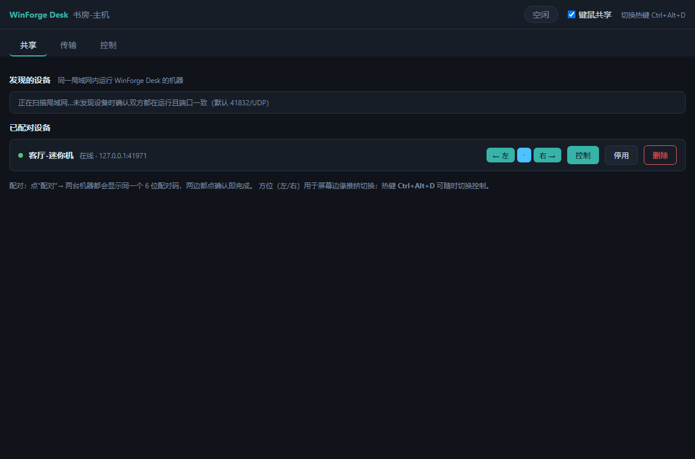
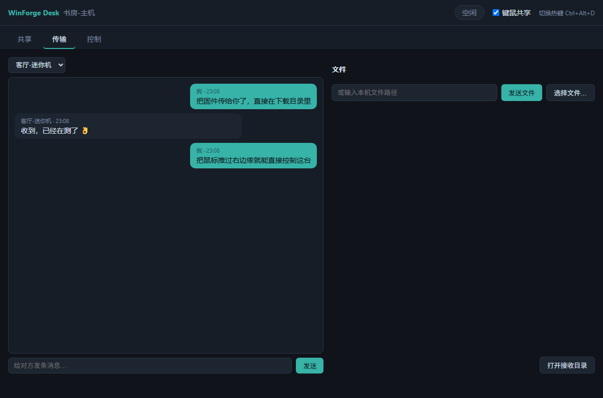

# WinForge Agent

从 macOS/Linux 安全地驱动一台 Windows 构建机，面向需要 Windows 厂商工具链、USB 烧录器和串口设备的嵌入式开发。

WinForge 是一个 Go 单二进制：同一程序在 Windows 上运行 Agent，在 Mac/Linux 上作为客户端使用。它不内置厂商 SDK、下载器、凭据或隐藏远控能力。

## 能力

- HTTPS + 自签名证书指纹固定；
- 256-bit 随机访问令牌；
- 文件访问限制在配置的 workspace root；
- 默认执行参数数组，不经过 shell；
- 实时返回 stdout/stderr，支持超时和取消；
- 原子上传、下载和目录创建；
- Windows 服务安装/卸载；
- 局域网 mDNS/DNS-SD 发现，构建机重启换 IP 后自动重新定位；
- Windows/macOS/Linux amd64/arm64 构建。

## Windows：初始化并启动

```powershell
winforge.exe init --config C:\ProgramData\WinForge\config.json `
  --root C:\WinForge --listen 0.0.0.0:9443

winforge.exe serve --config C:\ProgramData\WinForge\config.json
```

`init` 会打印一次配对命令。请通过可信通道复制到 Mac，不要把 token 写进聊天、工单或 Git。

安装为服务（在管理员终端执行）：

```powershell
winforge.exe service install --config C:\ProgramData\WinForge\config.json
```

## Mac：配对并操作

```bash
winforge discover                     # 列出局域网内的 Agent

winforge pair windows-lab \
  --instance '<discover 里的实例名>' \
  --token '<Windows init 输出>' \
  --fingerprint '<Windows init 输出>'

winforge status --profile windows-lab
winforge mkdir --profile windows-lab firmware
winforge upload --profile windows-lab ./firmware.zip firmware/firmware.zip
winforge exec --profile windows-lab --cwd firmware -- powershell.exe -NoProfile -File build.ps1
winforge download --profile windows-lab firmware/out/app.bin ./app.bin
```

固定 IP 也可以：把 `--instance` 换成 `--host https://192.0.2.50:9443`。两个一起给，
则平时走固定地址，连不上时才回退到发现。

## 局域网发现

Agent 默认用 mDNS/DNS-SD 公告 `_winforge._tcp`，实例名取主机名，可用 `instance_name` 配置项改，
`"advertise": false` 可完全关闭。公告内容只有实例名、主机名、端口和证书指纹，不含 token 和任何路径。

profile 里记了实例名后，客户端在原地址连不上时会自动在局域网里重新找一次——这正是构建机
重启后 DHCP 换了地址的场景。发现结果按不可信数据处理：候选地址必须先通过固定的证书指纹校验，
再成功调用一次 `status`，才会被写回 profile；指纹对不上的实例直接跳过，token 不会发给它。
指纹本身永远来自 Agent `init` 的带外输出，不从公告里采信。

多播不跨路由，也可能被 AP 的客户端隔离挡掉；这种情况下继续用 `--host`。

需要 shell 语法时必须显式调用 `cmd.exe /C` 或 `powershell.exe -Command`，Agent 不会偷偷拼 shell。

## 安全边界

WinForge 拥有启动进程和读写 workspace 的能力，因此只应部署在受信任网络中，并使用专门的低权限 Windows 账号运行。更多说明见 [SECURITY.md](SECURITY.md)。

## 多机协作：`winforge desk`（键鼠共享托盘）

双击 `winforgedesk.exe`（Windows 桌面入口，窗口 + 托盘）或运行 `winforge desk`（浏览器控制台），
同一局域网内安装了本程序的机器会互相发现。三大能力：

- **共享** — 多台电脑共用一套键鼠：把对端设为屏幕左/右方位后，鼠标推过对应
  屏幕边缘即可控制对方，对方推回共享边即交还；全局热键（默认 Ctrl+Alt+D）
  随时切换。
- **传输** — 控制台里互发消息与文件；接收文件经确认后保存到下载目录并做
  SHA-256 校验，文件名强制清洗、只写下载目录。
- **控制** — 任意已配对方向都可以发起/接受键鼠控制，共享开关关闭即拒绝。





配对流程：点"配对"→ 两台机器屏幕显示同一个 6 位配对码（由双端临时 X25519
ECDH 派生，两边不一致即说明有中间人）→ 双方各点一次"确认配对"完成，此后
用派生的 PSK 认证每次连接，会话流量全程 AES-256-GCM 加密。

```powershell
winforgedesk.exe                    # 桌面入口：Wails 窗口 + 托盘常驻（windowsgui 无黑窗；托盘/键鼠为 Windows 功能）
winforgedesk.exe --start-hidden     # 开机自启形态：只留托盘
winforge desk                       # CLI 入口：浏览器控制台（127.0.0.1，随机令牌）
winforge desk --no-tray             # 无头模式（自动化自测入口）
winforge desk autostart on|off|status
winforgedesk.exe autostart on|off|status   # GUI 入口同义（desk 前缀可省可留）
```

默认端口：发现 41832/UDP、会话 41831/TCP、控制台 41830（仅 127.0.0.1），
均可在配置文件（`%APPDATA%\winforge\desk.json`）修改。键鼠控制当前仅
Windows 实现；macOS/Linux 可用配对、消息、文件传输，构建不受影响。
GUI 版运行日志在 `%APPDATA%\winforge\desk.log`（超 5MB 自动轮转）。

## 故障排查

| 现象 | 处理 |
| --- | --- |
| 双击 winforgedesk.exe 没反应 | 看 `%APPDATA%\winforge\desk.log`；配置损坏会被自动备份为 `desk.json.bad-*` 并用默认配置启动 |
| 发现不了对方设备 | 确认双方都在运行且发现端口一致（默认 41832/UDP）；办公网 AP 隔离/UDP 被禁时改用"IP:控制端口"手动配对 |
| 热键不生效 | 多半被其他软件占用（日志里有提示），改 `desk.json` 的 `hotkey` 后重启；界面按钮永远可用 |
| 控制台打开是 401 | 控制台令牌每次启动重新生成，从日志里复制最新的 `http://127.0.0.1:.../?t=...` 链接 |
| 配对码两边不一致 | 网络路径上存在中间人，直接取消并重新发起；反复出现说明该网络不可信 |
| 控制时键盘"卡键" | 断开/交还时会自动补发抬起事件；如真机复现请带日志反馈 |
| 忘了配对过谁/想清空 | 控制台共享页可逐个删除；或直接删除 `desk.json`（会丢失全部配对，需重新配对） |
| 断线重连后消息没到 | 重连收敛窗口（数秒到数十秒）内互发的消息不补投，稍后重发即可；重连完成后消息通路自动恢复 |

## 开发

```bash
go test ./...
go vet ./...
make build
```

### desk 自测脚本（Windows，均需先构建对应 exe）

| 脚本 | 用途 |
| --- | --- |
| `py -3 smoke_desk.py` | 双实例单轮门禁：发现/配对/消息/32MB 文件/控制状态机/杀进程重连，必跑 |
| `py -3 soak_desk.py [轮数]` | 长稳 soak：N 轮双向消息+文件+开关共享循环 + 内存采样，抓长尾问题 |
| `py -3 uia_desk.py` | 桌面窗口 UIA 回归：真实渲染元素+三 tab 真实点击（需 pip 装 pywinauto） |
| `py -3 uia_pair_desk.py` | 桌面+浏览器双实例端到端：UIA 点击配对弹窗/实时气泡/传输接收全链 |
| `py -3 screenshot_desk.py` | 生成 README 控制台截图（无头 Chrome） |
| `node --check internal/desk/web/app.js` | 改前端后必跑（JS 语法门禁） |
